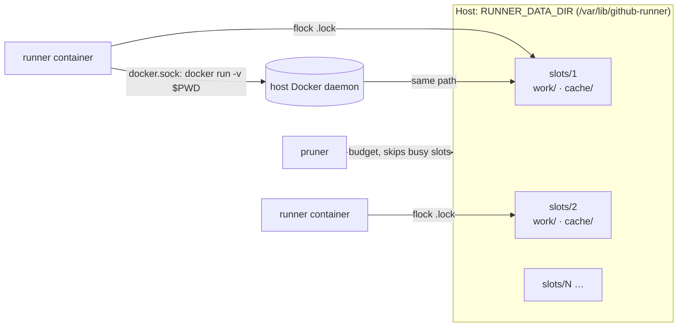

# GitHub Actions runner for Android, JVM and JavaScript

A self-hosted GitHub Actions runner image, plus a Docker Compose setup that
runs a fleet of them on anything from a Raspberry Pi 5 to a 64 GB build box.

```bash
docker pull ghcr.io/dodi-smart/github-runner:latest
```

**The image** builds on
[myoung34/github-runner](https://github.com/myoung34/docker-github-actions-runner)
and adds:

- the Temurin JDK, the Android SDK (platform, build-tools, platform-tools) and
  Node.js LTS, so jobs can skip `setup-java`, `setup-android` and `setup-node`;
- the usual CLI tools jobs reach for: `git`, `git-lfs`, `jq`, `yq`, `gh`,
  `zip`/`unzip`, `zstd`, `xxd`, `rsync` and `docker`;
- `rustup` on `PATH` without a toolchain: Rust toolchains install on first
  use (`dtolnay/rust-toolchain`, `rust-toolchain.toml`) into the runner's
  cache and are reused from then on, at no cost to the image size;
- multi-arch images (`linux/amd64`, `linux/arm64`), in three variants:
  `slim`, the default with the Android SDK, and `ndk`.

**The Compose setup** adds:

- **ephemeral runners**: one job per container, then a clean restart;
- **warm caches that survive**: per-runner caches for bun, npm, pnpm, Gradle,
  Cargo/rustup, Kotlin/Native, mise, hk, the Dart pub cache and the hosted
  tool cache;
- **one setting to size a host**, `RUNNERS=N`, plus a script that suggests it;
- **`docker run -v` and container actions that work**, because work dirs sit
  at the same path on the host and in the runner;
- **a pruner** that keeps every cache within a disk budget sized to the
  machine, without touching a cache while a job is using it;
- **a local action archive cache** that avoids GitHub's download rate limits.

## Contents

- [Quick start](#quick-start)
- [Sizing a host](#sizing-a-host)
- [Image variants and tags](#image-variants-and-tags)
- [How it works](#how-it-works)
- [Using it from workflows](#using-it-from-workflows)
- [Caches](#caches)
- [Maintenance](#maintenance)
- [Action archive cache](#action-archive-cache)
- [Configuration reference](#configuration-reference)
- [Troubleshooting](#troubleshooting)
- [Upgrading from named volumes](#upgrading-from-named-volumes)
- [Development](#development)

## Quick start

You need a Linux host with Docker Engine and the Compose plugin, and admin
rights on a GitHub organization.

**1. Create a GitHub App** that registers the runners. In your organization,
go to *Settings → Developer settings → GitHub Apps → New GitHub App*:

- **Organization permissions → Self-hosted runners:** Read and write.
- **Repository permissions → Contents:** Read-only. This is only needed if the
  [action archive cache](#action-archive-cache) should read private
  repositories.
- Turn off the webhook. Install the App on the organization, note its **App
  ID**, and generate a **private key**.

**2. Get the Compose files** onto the host:

```bash
git clone https://github.com/dodi-smart/docker-github-actions-runner-android.git runners
cd runners
cp .env.example .env
```

**3. Size the host.** The script only reads; it changes nothing. Choose
`light` for checks, lint and JS builds, or `large` for Gradle and Android
builds:

```bash
hosts/sizing.sh light
```

Paste its suggestions (`RUNNERS`, `RUNNER_CPUS`, `RUNNER_MEMORY`, and
`RUNNER_IMAGE` on arm64) into `.env`.

**4. Fill in `.env`.** At minimum set `APP_ID`, `APP_PRIVATE_KEY` (the PEM on
one line, with `\n` for newlines) and `APP_LOGIN` (the organization). Then set
the labels your workflows will select on, for example `LABELS=docker,light`.

**5. Start the fleet:**

```bash
docker compose up -d
docker compose logs -f runner   # each runner logs the slot it claimed
```

The runners show up under the organization's *Settings → Actions → Runners*.
Point a workflow at them with `runs-on: [self-hosted, Linux, light]`.

To update a host later:

```bash
git pull && docker compose pull && docker compose up -d
```

## Sizing a host

Every host runs the same Compose file. Only `.env` differs. `hosts/sizing.sh`
reads the host's CPUs, memory and disk:

- it fits as many runners as both CPU and memory allow for the chosen profile;
- `light` gives each runner 1 CPU and 3 GiB, `large` gives 2 CPUs and 6 GiB;
- it keeps 2 GiB of memory for the host itself.

Typical results:

| Host | Profile | Suggested `.env` |
|---|---|---|
| Raspberry Pi 5, 8 GB (arm64) | light | `RUNNERS=2`, `RUNNER_IMAGE=…:slim`. The cache budget shrinks with the disk on its own. |
| Hetzner CPX31, 4 vCPU / 8 GB | light | `RUNNERS=2`, `RUNNER_CPUS=1`, `RUNNER_MEMORY=3g` |
| Hetzner CX43, 8 vCPU / 16 GB | light or large | `RUNNERS=4` (light) or `RUNNERS=2` (large) |
| 64 GB mini PC / build box | large | as many as CPU allows, e.g. `RUNNERS=6`, `RUNNER_CPUS=2`, `RUNNER_MEMORY=6g` |

What the knobs do:

- **`RUNNER_CPUS` / `RUNNER_MEMORY`** cap each runner, so one heavy job cannot
  starve its neighbours. Under a CPU cap the runner also caps Gradle
  (`org.gradle.workers.max`), Cargo, `make` and CMake parallelism to it. A
  container otherwise sees every host CPU and spawns a worker for each. Leave
  both unset, or `0`, for no limit.
- **Labels** describe capability, not machine names. A host can carry several,
  so a big machine labelled `light,large` also picks up light jobs.
  `RUNNER_<n>_LABELS` gives runner slot *n* its own set, for example one
  `large` runner on an otherwise `light` host.
- **Coordination runners:** `CONTROL_RUNNERS=2` adds runners that carry only
  `CONTROL_LABELS` (default `control`). They have no Docker socket and no
  caches. Point the short jobs a merge waits on (pickers, required summary
  jobs) at them, so those never queue behind builds.
- **Tiny disks:** the pruner's budget already scales with the disk. If even
  that is too much, `RUNNER_CACHES=off` runs without caches.

## Image variants and tags

Images are published to `ghcr.io/dodi-smart/github-runner` for `linux/amd64`
and `linux/arm64`.

| Variant | Contents | Use it for |
|---|---|---|
| `slim` | JDK, Node, CLI tools; **no Android SDK** | arm64 hosts (Android's build tools are x86_64-only), JS/JVM-only pools, small disks |
| default | `slim` + Android SDK (platform, build-tools, platform-tools) | Android and general CI |
| `ndk` | default + NDK and CMake | projects with native (C/C++) code |

The Android SDK sits in one layer that is identical across every JDK and Node
tag, so a host running several tags downloads it once.

| Tag | Pins |
|---|---|
| `latest` | nothing: newest JDK + Node LTS, default variant |
| `jdk21`, `node22` | that JDK or Node major |
| `jdk21-node22` | both majors |
| `slim`, `ndk` | the variant, with the default JDK + Node |
| `2.338.0-jdk21-sdk37.2-node24` | everything: runner, JDK, SDK and Node. Never overwritten |
| `2.338.0-jdk21-sdk37.2-bt37.0.0-node24` | the same image with build-tools spelled out |

The long tags let a consumer have Renovate derive its Gradle `compileSdk` and
`buildToolsVersion` from the image pin, so AGP doesn't download SDK components
on every job.

JDKs: the LTS lines (17, 21, 25) plus the newest GA release. Node: the current
LTS lines. [`matrix.json`](matrix.json) is the source of truth. A weekly job
proposes new JDK, Node, SDK, build-tools and NDK versions. Each image carries
`RUNNER_IMAGE_TAG` and `RUNNER_IMAGE_REVISION`, so a job can tell what it ran
on.

A project that needs another Android platform installs it in the job, e.g.
`sdkmanager "platforms;android-34"`.

## How it works



- **Slots.** Each runner container claims the lowest free slot under
  `RUNNER_DATA_DIR/slots/` and holds a lock on it for its whole life. Its work
  dir and every cache live in that slot, so no two running jobs ever share a
  cache. Scaling to `RUNNERS=N` just means N slots.
- **Ephemeral.** A runner takes one job, deregisters and exits.
  `restart: unless-stopped` brings it back to register afresh. `/tmp` and
  other leftovers are wiped after each job; the slot's caches stay.
- **Same path on host and container.** `RUNNER_DATA_DIR` is mounted at the
  same path inside the containers. When a job hands a path to the host's
  Docker daemon (`docker run -v "$PWD:/src"`, a container action, a
  `container:` job), the daemon finds the same files.
- **Cache links.** The tools' default locations (`~/.gradle`, `~/.bun`,
  `/opt/hostedtoolcache`, …) are symlinks into the slot. Workflows don't need
  any cache configuration.
- **Self-healing registration.**
  [`preflight-entrypoint.sh`](preflight-entrypoint.sh) wipes a stored runner
  registration only after GitHub confirms that runner is gone (`404`). A
  deleted runner then registers again instead of crash-looping.

## Using it from workflows

```yaml
jobs:
  build:
    runs-on: [self-hosted, Linux, large]
    steps:
      - uses: actions/checkout@v4
      - run: ./gradlew assembleDebug   # JDK, SDK and ~/.gradle are warm already
```

- **Keep the tools' default cache locations.** If a job moves
  `GRADLE_USER_HOME`, `BUN_INSTALL_CACHE_DIR` or `PUB_CACHE` into
  `$RUNNER_TEMP`, the warm caches go unused.
- **Skip the GitHub cache where a runner cache replaces it,** e.g.
  `cache: false` on `jdx/mise-action` and `setup-node`. With `actions/cache`
  and the bun cache, use an exact key (no `restore-keys`), so a bad entry
  cannot come back.
- **Docker works.** Use `docker build`, `docker run -v`, service containers
  and container actions as on GitHub-hosted runners. Ports a job's containers
  publish open on the host, not on the runner's `localhost`.
- **Jobs run as root.** Tool archives unpack root-owned
  (`TAR_OPTIONS=--no-same-owner`), so git does not refuse a Flutter SDK it
  unpacked.

## Caches

Each slot keeps one directory per tool under `slots/<n>/cache/`:

| Store | Linked from | Evicted as |
|---|---|---|
| bun | `~/.bun` | whole packages; never `bin/` |
| npm | `~/.npm` | files (content-addressed) |
| pnpm | `~/.local/share/pnpm`, `~/.cache/pnpm` | the whole store |
| gradle | `~/.gradle` | whole dependency versions, transforms, wrapper dists |
| cargo | `~/.cargo` | crates, unpacked sources, git checkouts; never `bin/` |
| rustup | `~/.rustup` | whole toolchains; never the default. rustup itself is set up in `~/.cargo` on first start |
| konan | `~/.konan` | whole dependencies and prebuilt compilers |
| mise | `~/.local/share/mise`, `~/.cache/mise` | whole tool versions; downloads as files |
| hk | `~/.cache/hk` | files |
| pub | `~/.pub-cache` | whole packages |
| toolcache | `/opt/hostedtoolcache` | whole tool versions (setup-* actions, Flutter) |

Entries are evicted whole wherever a partial entry would break a build. A
package folder missing one file still looks complete to bun.

## Maintenance

The `pruner` service ([`pruner.sh`](pruner.sh)) keeps slow work off the job
path:

- **Cache budget.** Each host gets `CACHE_BUDGET_BYTES` (default 60 GiB) or
  `CACHE_BUDGET_PCT` of the data disk (default 40 %), whichever is smaller,
  split evenly across the slots. Within a slot, least recently used entries
  go first, across all stores.
- **Never under a running job.** A slot whose runner is in a job is skipped.
  A job that starts while the pruner works on its slot waits for it, up to
  `PRUNE_WAIT_SECONDS`.
- **Adaptive.** It runs daily, and early when free disk drops below
  `PRUNE_FREE_PCT`. Then `docker system prune` / `docker builder prune` clean
  old images and build cache, more aggressively when disk is tight.
- **Hourly:** it fills the action archive cache.

After each job, [`cleanup.sh`](cleanup.sh) does a quick tidy-up only: `/tmp`,
Gradle daemons and locks, and runner logs.

To run a maintenance pass by hand:

```bash
docker compose run --rm -e PRUNE_RUN_ONCE=true pruner
```

## Action archive cache

Ephemeral runners download every `uses:` action for every job. Several
runners behind one IP address soon hit `429 Too Many Requests` in "Set up
job".

How the cache avoids that:

- The runner reads archives from `ACTIONS_RUNNER_ACTION_ARCHIVE_CACHE`
  (`/opt/actionarchivecache`, read-only in every runner) before downloading.
- The pruner fills that directory hourly, as the GitHub App. Downloads count
  against the App's limit, not your IP.
- It fetches every `uses:` found in `PREFETCH_SOURCES` (e.g. the repo that
  holds your reusable workflows), plus `PREFETCH_EXTRA`.
- A cache miss falls back to a normal download.

To fill it straight away:

```bash
docker compose run --rm pruner prefetch
```

To confirm it works, re-run a job with debug logging. "Set up job" then shows
`Copied action archive '/opt/actionarchivecache/...'`.

## Configuration reference

Set these in `.env`. [`.env.example`](.env.example) has them all, with
comments.

| Variable | Default | Purpose |
|---|---|---|
| `APP_ID`, `APP_PRIVATE_KEY`, `APP_LOGIN` | — | GitHub App and organization (required) |
| `RUNNERS` | `3` | runners on this host |
| `RUNNER_DATA_DIR` | `/var/lib/github-runner` | host directory for slots (work dirs + caches) |
| `LABELS` | `docker` | labels for every runner |
| `RUNNER_<n>_LABELS` | — | labels for slot *n* only |
| `RUNNER_CPUS`, `RUNNER_MEMORY` | none | per-runner limits (e.g. `2`, `6g`) |
| `RUNNER_CACHES` | `on` | `off` runs without caches |
| `CONTROL_RUNNERS`, `CONTROL_LABELS` | `0`, `control` | coordination runners |
| `RUNNER_IMAGE` | `ghcr.io/dodi-smart/github-runner` | image or tag (e.g. `:slim`) |
| `RUNNER_NAME_PREFIX`, `RUNNER_GROUP` | `runner`, `Default` | runner name and group |
| `CACHE_BUDGET_BYTES`, `CACHE_BUDGET_PCT` | 60 GiB, `40` | pruner cache budget per host |
| `PRUNE_FREE_PCT`, `PRUNE_INTERVAL_SECONDS` | `15`, `86400` | when the pruner runs |
| `PREFETCH_SOURCES`, `PREFETCH_EXTRA` | — | action archive cache sources |
| `DISABLE_AUTO_UPDATE` | empty | any non-empty value (even `false`) disables runner self-update |

`EPHEMERAL` and `DISABLE_AUTO_UPDATE` count as set for any non-empty value,
because the upstream entrypoint only checks whether they are empty.

## Troubleshooting

- **A runner restarts in a loop.** Run `docker compose logs runner`. Check the
  App ID, the key (one line, `\n` escapes) and that the App is installed on
  `APP_LOGIN` with *Self-hosted runners: Read and write*.
- **Which slot is a runner on?** The first log line says
  `[preflight] slot <n> (...)`. Inside a job, `$RUNNER_SLOT` and
  `$RUNNER_SLOT_DIR` say the same.
- **The disk fills up.** Lower `CACHE_BUDGET_BYTES`, then run a maintenance
  pass by hand (see [Maintenance](#maintenance)). `du -sh
  $RUNNER_DATA_DIR/slots/*/cache/*` shows what is big.
- **A job fails with a corrupt cache.** Stop that slot's runner, delete the
  store (`rm -rf $RUNNER_DATA_DIR/slots/<n>/cache/<store>`) and start it
  again. It refills on the next job.
- **Don't put `RUNNER_DATA_DIR` on NFS.** Slot locks use `flock`, which needs
  a local filesystem.

## Upgrading from named volumes

Earlier versions used three hard-coded runner services, each with its own
named volumes. To move to slots:

```bash
git pull
docker compose down
# set RUNNERS (and CONTROL_RUNNERS=2 if you used COMPOSE_PROFILES=control) in .env
docker compose up -d
```

What changes:

- Caches start cold once and warm up within a few jobs.
- The old volumes stay until you delete them with
  `docker volume ls -q | grep -E '_runner-(work|bun|npm|pnpm|gradle|cargo|rustup|konan|mise|hk)' | xargs docker volume rm`.
- `COMPOSE_PROFILES=control` and `hosts/no-caches.compose.yml` are gone,
  replaced by `CONTROL_RUNNERS` and `RUNNER_CACHES=off`.

## Development

- [`build.yml`](.github/workflows/build.yml) builds and smoke-tests every pull
  request and runs the script tests. Its `All builds passed` check is the one
  to require.
- [`deploy.yml`](.github/workflows/deploy.yml) publishes the images from
  `main`.
- Renovate keeps the base image and the actions current (`forkProcessing` is
  on: this repo is a fork of
  [compscidr/docker-github-actions-runner-android](https://github.com/compscidr/docker-github-actions-runner-android)).

Build and test locally:

```bash
docker build --target runner --build-arg JAVA_VERSION=21 --build-arg NODE_VERSION=24 .
docker run --rm -v "$PWD:/w" -w /w ubuntu:24.04 bash -c 'for t in tests/*.sh; do bash "$t"; done'
shellcheck -x *.sh hosts/*.sh tests/*.sh
```

The build args and their defaults are at the top of the
[`Dockerfile`](Dockerfile).
